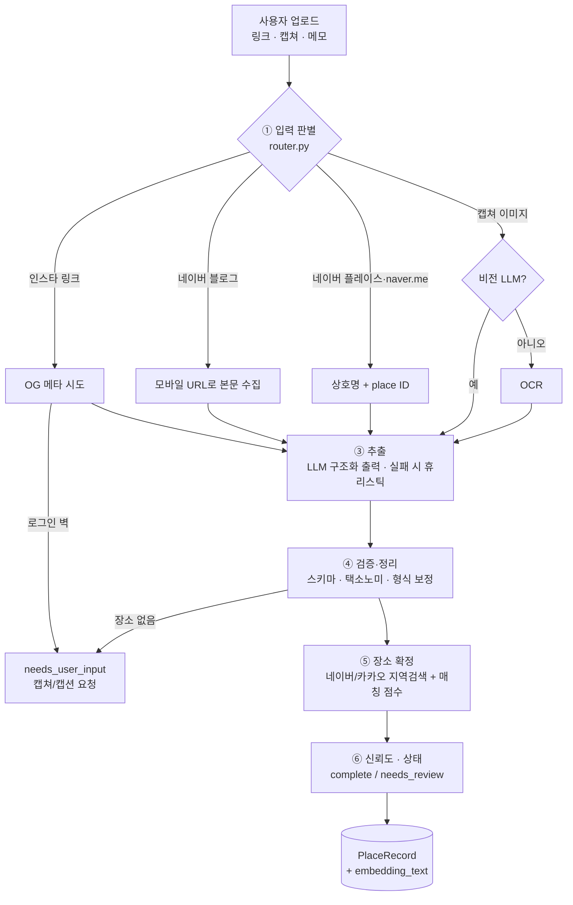

# 워크플로우 설계

## 단계별 책임

| 단계 | 모듈 | 입력 → 출력 | 실패 시 |
|---|---|---|---|
| ① 판별 | `router.py` | 문자열 → `RoutedInput(kind, source_type, ids)` | 알 수 없으면 일반 웹링크/텍스트로 처리 |
| ② 수집 | `fetchers/` | URL → `FetchedContent(title, text, status)` | `blocked` + 메모 없음 → **사용자에게 캡쳐 요청** |
| ② 이미지 | `llm` 비전 / `ocr.py` | PNG → 이미지 바이트 또는 OCR 텍스트 | 둘 다 없으면 `failed` |
| ③ 추출 | `llm/providers.py`, `heuristic.py` | 프롬프트 → `ExtractionResult(places[])` | LLM 오류 시 휴리스틱으로 대체(텍스트 입력만) |
| ④ 정리 | `pipeline._sanitize`, `models.py` | 원시 JSON → 검증된 모델 | 스키마 밖 값은 `other`/null 로 |
| ⑤ 확정 | `geo.py` | 이름·주소 단서 → 지도 후보 + 점수 | 점수 < 0.75 → 주소 단서만 저장, `needs_review` |
| ⑥ 상태 | `pipeline._to_record` | → `PlaceRecord` | 사유를 `review_reasons` 에 기록 |

## 신뢰도 계산
- 지도 확정 성공: `overall = 0.5 × 추출 확신도 + 0.5 × 지도 매칭 점수`
- 지도 확정 실패: `overall = min(추출 확신도, 0.6)` → 항상 `needs_review`
- 지도 미사용(geo=none): `overall = 추출 확신도 × (주소 있으면 0.85, 없으면 0.7)`
- `overall ≥ 0.7` 이고 검토 사유가 없을 때만 `complete`

## 지도 매칭 점수 (`geo.score_candidate`)
- 이름 유사도(정규화 후 완전일치 1.0 / 포함 0.9 / 그 외 SequenceMatcher)
- 주소 단서가 있으면 `0.6 × 이름 + 0.4 × 주소 토큰(구·동·로·길) 겹침 비율` → **같은 상호의 다른 지점을 걸러냄**
- 지역 단서만 있으면 일치 시 +0.05, 불일치 시 ×0.9

## 카테고리 결정 순서
1. LLM(또는 휴리스틱)이 택소노미 안에서 고른 값
2. 지도 API 카테고리가 다른 대분류를 가리키면 **지도 기준**으로 바꾸고 사유 기록
3. 휴리스틱 키워드 규칙: 짧은 텍스트(상호명)는 **마지막 핵심어**("바다정원 글램핑" → 숙소), 긴 본문은 **처음 나온 키워드**, 구체 키워드가 "카페·맛집" 같은 일반 키워드보다 우선

## 중복 처리 (`dedupe_key`)
`kakao:{id}` → `naver:{id}` → `name:{상호+지점}@{시군구}` 순서. 같은 키가 다시 들어오면 출처를 합치고 비어 있는 값만 채웁니다.

## 추천 단계로 넘기는 것
- `embedding_text`: `상호 | 대분류/소분류 | 지역 | #태그 | 가격대 | 대표메뉴 | 요약` — 임베딩해서 벡터 검색
- 필터용 구조화 필드: `classification.primary_category`, `tags`, `details.price_level`, `place.location`, `place.address.sigungu`

---
## v0.2 추가 단계
저장 파이프라인 끝에 **정보 보강(`enrich.py`)** 이 붙었습니다: 영업시간 원문 → 구조화(`hours.py`), 체류시간·실내 여부·1인 비용 기본값(출처 `default:*`로 표시), 필드별 출처(`provenance`), 비어 있는 핵심 정보(`missing_fields`).
저장된 장소는 **코스 추천(`route.py`)** 의 입력이 됩니다. 컨셉·규칙은 [03_product_plan.md](03_product_plan.md) 참고.
